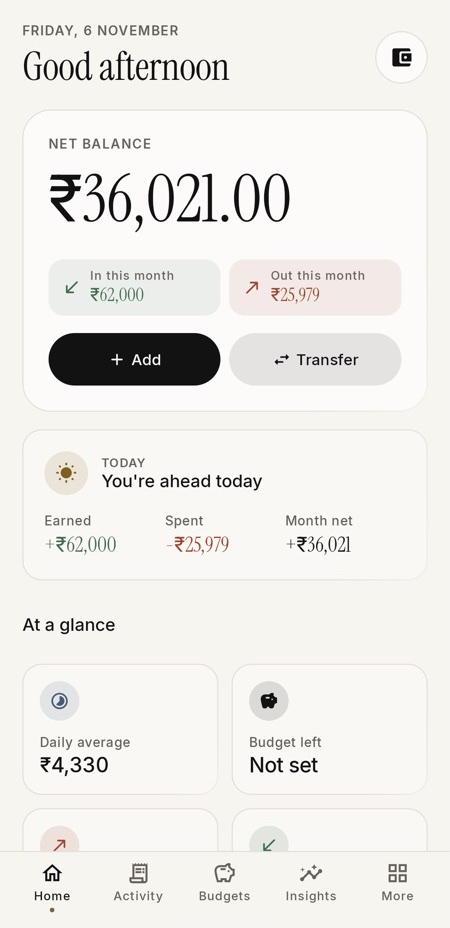
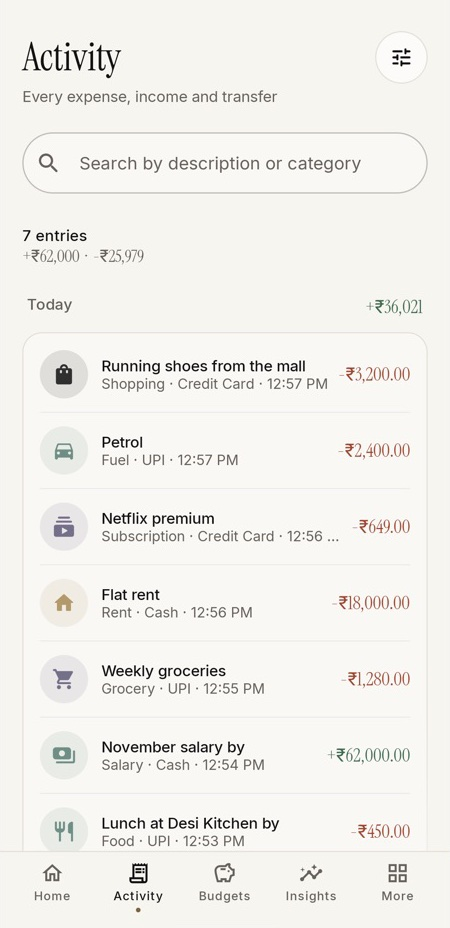
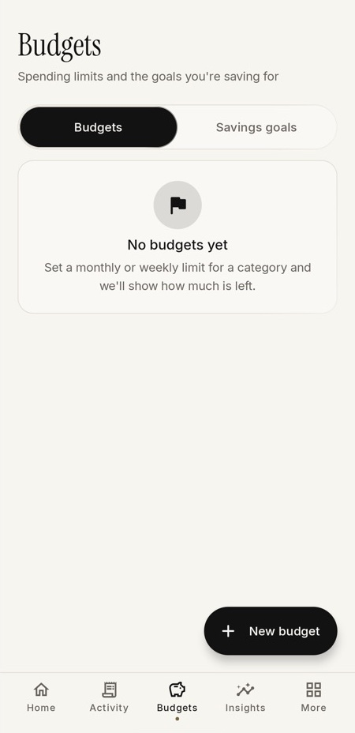
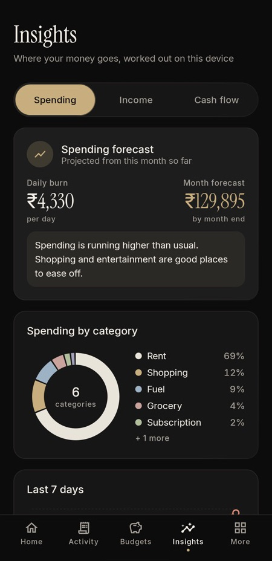

# AkSpend

A private expense tracker for Android that works completely offline. There's no account, no cloud and no internet permission, so your money data stays on your phone.

[Website](https://akshar2324.github.io/Expanse-Tracker/) · [Privacy policy](https://akshar2324.github.io/Expanse-Tracker/privacy.html) · [Latest release](https://github.com/akshar2324/Expanse-Tracker/releases/latest)

<p>
  
  
  
  
</p>

## Features

**Log spending fast**
- Income, expenses and transfers between accounts, with category, payment method and account
- Type sums like `120/3+5` in the amount field
- Quick-add and budget widgets on the home screen

**Import from your bank**
- Paste or share a bank SMS and AkSpend fills in the amount, merchant, date and account for you to check
- Optional auto-import reads payment notifications from messaging, bank and UPI apps. Each one waits in a review list until you confirm it, and the message text is never saved
- Import bank statements from CSV, with a staged preview
- Duplicate guard: warns when an import matches something already saved, by statement row or by same amount on the same day
- Category memory: remembers the category you chose for a merchant and suggests it next time

**Plan and understand**
- Monthly and weekly budgets, savings goals, debts you lent or borrowed, and recurring payments
- Month-end balance forecast and a subscription finder
- Insights with category and cash-flow charts, plus a weekly digest
- Search with filters for type, account, amount and date range, and saved filters

**Private by design**
- No internet permission, no analytics, no ads
- App lock with your own passcode (stored as a salted hash) and fingerprint unlock. It relocks after 30 seconds away and limits wrong tries
- Automatic backups to a folder you choose, optionally encrypted with a password (AES-256-GCM)
- JSON backups are validated before a restore replaces anything
- Two looks: Atelier (default) and Liquid glass, each with light and dark mode

## Privacy

Everything is stored in the app's private storage on the device. Data leaves the phone only when you export or share it. Android Auto Backup is turned off for app data. Bank messages are parsed on the device by [txnparse](https://github.com/akshar2324/txnparse), a small open-source library.

Details: [privacy policy](https://akshar2324.github.io/Expanse-Tracker/privacy.html) and [privacy model](docs/privacy-model.md).

## Build and run

Requirements: Android Studio with its bundled JDK (or JDK 17+) and the Android SDK for compile SDK 36.

```bash
git clone https://github.com/akshar2324/Expanse-Tracker.git
cd Expanse-Tracker
./gradlew assembleDebug
```

Or open the project in Android Studio and run the `app` configuration.

| | |
| --- | --- |
| Version | 1.5.0 (versionCode 7) |
| Min / target SDK | 24 (Android 7.0) / 36 |
| Bank SMS import | Android 8.0+ |
| Database | Room, schema version 7 |

## Tests and checks

Run this before opening a pull request. It's the same set CI runs:

```bash
./gradlew compileDebugKotlin testDebugUnitTest lintDebug assembleDebug
./scripts/repo_guard.sh
```

Unit tests use JUnit, Robolectric and MockK. They cover money parsing and rounding, budgets, forecasts, CSV import, backup encryption and validation, the app lock, Room migrations, and Compose screens. Roborazzi screenshot tests write images to `app/build/outputs/roborazzi/`. The repo guard checks that no secrets, signing files or network permissions were added.

[`AUDIT_REPORT.md`](AUDIT_REPORT.md) lists the findings from the last audit and which are still open.

## Project layout

```text
app/src/main/java/com/akshar/
  data/
    activity/     Search filters and saved filters
    backup/       JSON backups, encryption, automatic backups
    db/           Room database, DAOs and migrations
    model/        Entities
    repository/   Repository layer
  insights/       Forecast, subscription finder, weekly digest
  security/       App lock and biometric helpers
  sms/            Bank SMS import and the notification review inbox
  ui/
    components/   Shared Compose components
    screens/      Screens
    theme/        Atelier and Liquid glass styles
    viewmodel/    ViewModels
  utils/          Money, budget, CSV, duplicate and category helpers
  widget/         Quick-add and budget widgets
docs/             Website, privacy policy, store listing, release notes
scripts/          Repository guard
```

## Release signing

Release builds read `keystore.properties` from the project root:

```properties
RELEASE_STORE_FILE=path/to/upload-key.jks
RELEASE_STORE_PASSWORD=...
RELEASE_KEY_ALIAS=...
RELEASE_KEY_PASSWORD=...
```

Then build the bundle with `./gradlew bundleRelease`. Keystores, `keystore.properties`, `google-services.json` and generated APKs and bundles are ignored by git; never commit them. The full process is in the [release checklist](docs/release-checklist.md), and the store copy is in the [Play Store listing](docs/play-store-listing.md).

## Contributing

Keep the app private, offline and easy to maintain:

- No network features, telemetry, analytics or cloud-only behaviour.
- Never use destructive Room migrations. When you add or change a persisted model, bump the version and add a migration.
- Handle money with explicit rounding, and test the edge cases: signs, zero, locale formats and limits.
- Add tests for changed financial logic, persistence, backup and restore, and ViewModels.
- Keep each pull request focused, and run the checks above.

The package name `com.akshar` is a technical identifier kept for compatibility. The app's name is AkSpend everywhere users see it.

Security issues: see [SECURITY.md](SECURITY.md).

## License

[MIT](LICENSE)
